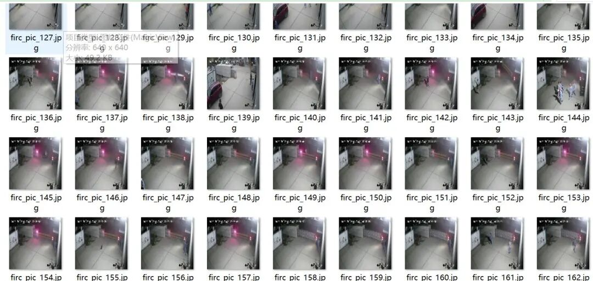
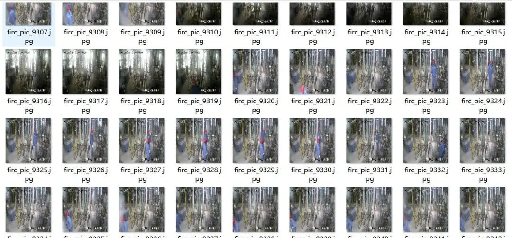
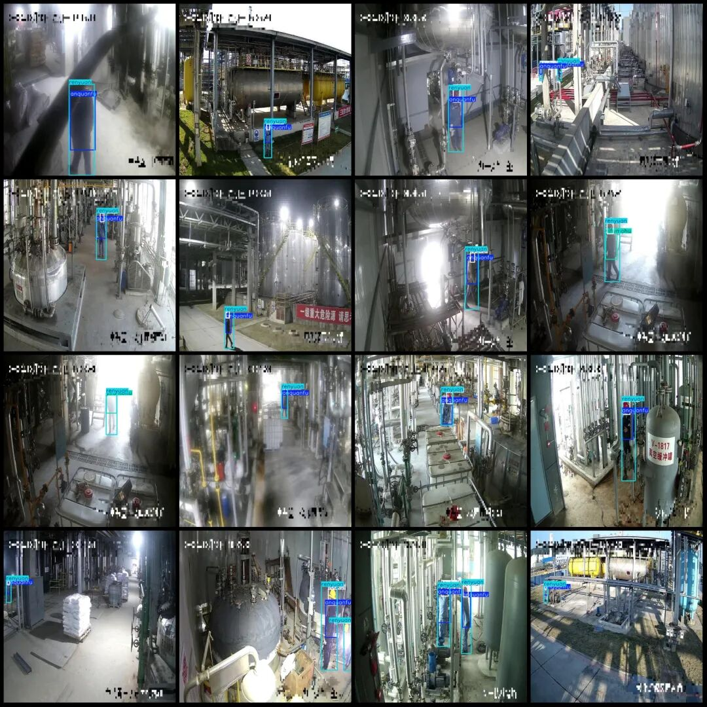
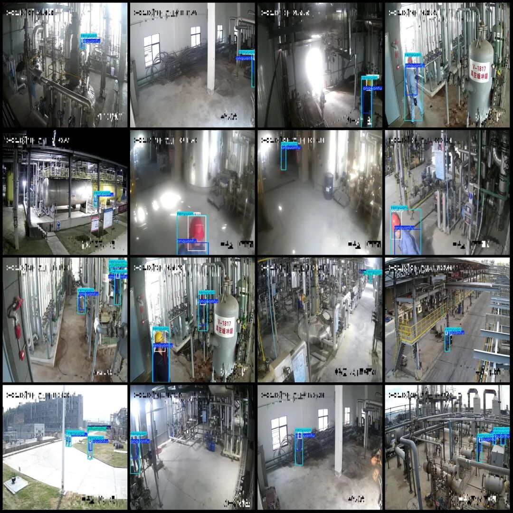

# Smart Factory Monitoring Perspective: Industrial Park Safety Equipment and Protective Measures Detection Data Set in VOC+YOLO format with 12369 images across 7 categories

Dataset format: Pascal VOC format + YOLO format (txt file without split path, only containing jpg images and corresponding VOC format xml files and yolo format txt files)

Number of images (number of jpg files): 12369

Number of annotations (number of xml files): 12369

Number of annotations (number of txt files): 12369

Label category count: 7

Label category names (Note that the order of categories in the Yolo format does not correspond to this, but is based on the classes.txt file in the labels folder): ["anquanfu", "bianfu", "renyuan", "toubu", "toubumohu", "toukui", "yifumohu"]

Category: ["Safety Clothes", "Casual Wear", "Personnel", "Headwear", "Halo Headgear", "Clothing Blurry"]

Number of boxes labeled in each category:

anquanfu frame count = 14809

Bianfu Frames = 779

Renyuan frame count = 17004

Toubu Frames = 1199

Toubumohu Frames = 1131

Toukui Frames = 14295

yifumohu frame count = 1322

Total frames: 50539

Number of images per category:

anquanfu occupies the number of images = 11184

Bianfu's possession of images = 711

Renyuan's number of images = 12359

Toubu's number of images = 878

Toubumohu owns 1001 images.

Toukui's total number of images = 10869

yifumohu occupies the number of images = 1147

Image resolution: 640x640

Using labelImg:

Annotation rules: Draw a rectangle around the category.

Important Notice: The dataset does not have separate training, validation, and test sets; you need to partition them yourself.

Special : This dataset does not guarantee the accuracy of the trained models or weight files.

Image Preview:

Annotation example:

## Payment

Here is a pay link on Stripe ( https://buy.stripe.com/3cs8yP7sY87d0vu9AB ). Please contact me lonlonago@foxmail.com after funding $89, and I will send you a complete data files , thank you!

